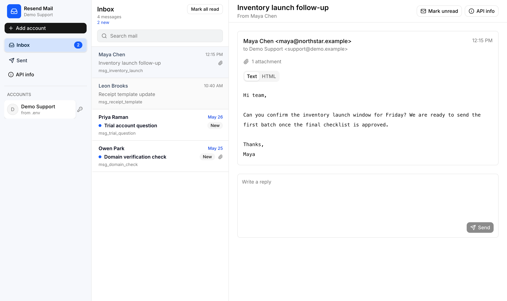
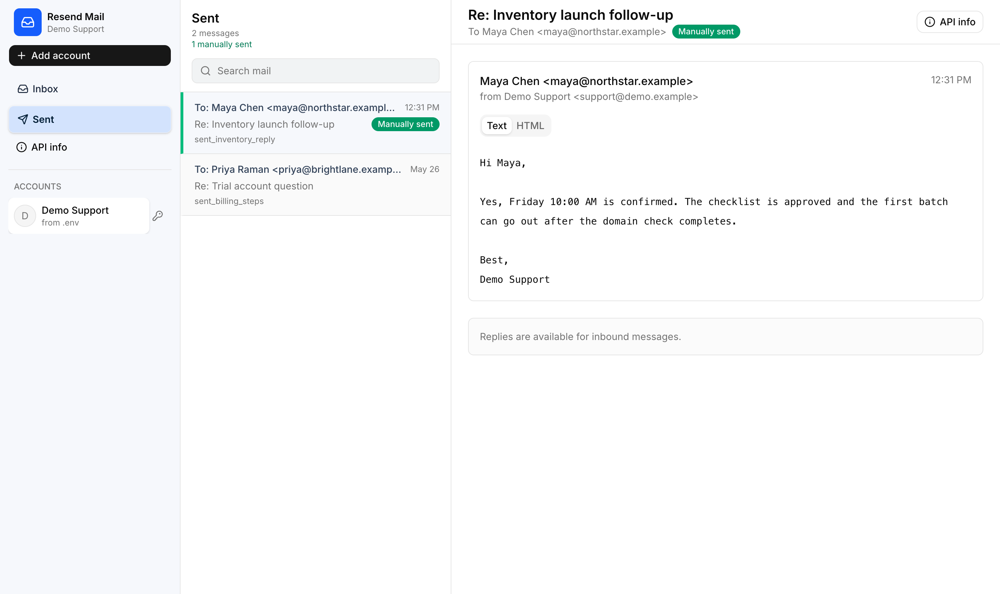

# Resend Mail Client

A simple mail client for working with Resend accounts.

It gives you a familiar inbox, sent folder, account switcher, message view, and reply box in one focused local app. It is meant for checking received mail, replying quickly, and moving between multiple Resend accounts without needing a separate dashboard flow.

The app keeps the main screen clean by default and shows extra account or message details only when you ask for them.

## Features

- Familiar inbox layout with a clear folder sidebar, message list, and reading pane.
- Inbox messages show unread state, new badges, attachment indicators, and selected-message highlighting.
- Clicking the active Inbox or Sent folder refreshes the current mail list and shows progress in place.
- Messages can be opened in a full reading view with sender, recipient, time, body, and attachment count.
- Replies are available directly from inbound messages, so you can answer without leaving the current view.
- Sent mail has its own folder and clearly marks replies sent from this client.
- Multiple accounts can be added and switched from the sidebar, with each account showing its own inbox, sent mail, read state, and sent markers.
- A default local account can be loaded from environment settings, while extra accounts can be added in the browser for quick testing.
- Read and unread state is remembered locally, including a confirmed action to mark all inbox messages as read.
- Optional API information is available on demand for account and message details, while the default interface stays simple.

## Screenshots





## Run Locally

```bash
cp .env.example .env
npm install
npm run dev
```

Open `http://localhost:3000`.

To use a default local account, add your Resend key and sender address to `.env`:

```bash
RESEND_FULL_ACCESS="re_..."
RESEND_FROM_EMAIL="Name <you@example.com>"
```
